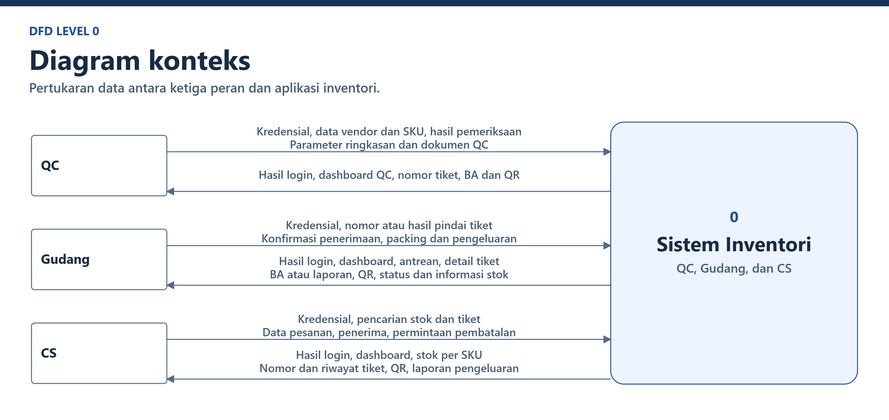
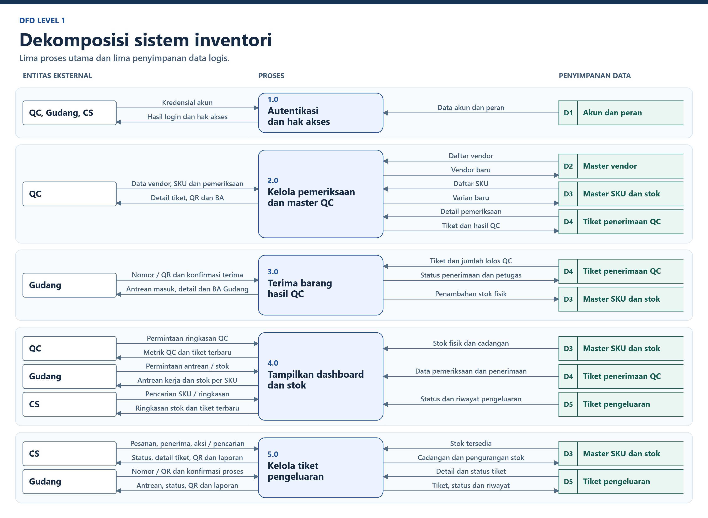

# Data Flow Diagram Sistem Inventori

DFD ini menggambarkan data yang dikirim, diproses, dan disimpan oleh aplikasi inventori. Tiga peran yang berinteraksi langsung dengan aplikasi adalah **QC**, **Gudang**, dan **CS**.

## DFD Level 0 — Diagram Konteks

| Entitas | Data masuk ke sistem | Data keluar dari sistem |
|---|---|---|
| **QC** | Kredensial, data vendor dan SKU, nomor surat jalan, tanggal, dan hasil pemeriksaan. | Hasil login, ringkasan pemeriksaan, tiket QC, QR, dan berita acara (BA). |
| **Gudang** | Kredensial, nomor atau hasil pindai tiket, konfirmasi penerimaan, packing, dan pengeluaran. | Hasil login, dashboard dan antrean, detail serta status tiket, informasi stok, QR, dan dokumen. |
| **CS** | Kredensial, pencarian SKU atau tiket, data penjualan dan penerima, serta permintaan pembatalan. | Hasil login, dashboard dan stok per SKU, nomor dan riwayat tiket, QR, dan laporan pengeluaran. |

Informasi dari vendor dan pembeli dimasukkan oleh QC dan CS. Gudang mencatat serah terima kepada kurir melalui konfirmasi pengeluaran.

## DFD Level 1 — Proses dan Penyimpanan Data

+ Kotak putih menunjukkan entitas eksternal, kotak biru menunjukkan proses, dan kotak hijau terbuka menunjukkan penyimpanan data. Label pada panah menunjukkan data yang berpindah sesuai arah panah.
+ Simbol yang berulang dengan nama atau kode yang sama merujuk pada entitas atau penyimpanan yang sama.

| Proses | Pengolahan data |
|---|---|
| **1.0 Autentikasi dan hak akses** | Memeriksa kredensial menggunakan data akun dan menentukan akses peran. |
| **2.0 Kelola pemeriksaan dan master QC** | Membaca atau menambahkan vendor dan SKU, menyimpan hasil pemeriksaan, serta menampilkan tiket, QR, dan BA. |
| **3.0 Terima barang hasil QC** | Membaca tiket dan jumlah lolos. Saat Gudang mengonfirmasi penerimaan, sistem mencatat petugas dan status penerimaan serta menambah stok fisik. |
| **4.0 Tampilkan dashboard dan stok** | Membaca hasil pemeriksaan, data penerimaan, stok, dan status pengeluaran untuk menampilkan informasi sesuai peran. |
| **5.0 Kelola tiket pengeluaran** | Memvalidasi permintaan CS terhadap stok tersedia, mencadangkan stok, serta mencatat status dan riwayat tiket. Konfirmasi barang keluar mengurangi stok fisik dan cadangan. Pembatalan sebelum pengiriman melepas cadangan. |

### Penyimpanan data

| ID | Penyimpanan logis | Tabel aplikasi |
|---|---|---|
| **D1** | Akun dan peran | `users` |
| **D2** | Master vendor | `inventory_vendors` |
| **D3** | Master SKU, stok fisik, dan stok dicadangkan | `inventory_variants` |
| **D4** | Tiket penerimaan dan rincian pemeriksaan | `inventory_tickets`, `inventory_receipts` |
| **D5** | Tiket pengeluaran, rincian barang, dan riwayat status | `inventory_dispatches`, `inventory_dispatch_lines`, `inventory_dispatch_events` |

## Ekspor ke PDF

Buka pratinjau Markdown, lalu pilih **Cetak → Simpan sebagai PDF**. Gunakan **A4 lanskap** dan periksa skala agar label panah terbaca. Jika dokumen dipindahkan, sertakan folder `output/dfd-inventory` agar gambar tetap tampil.
