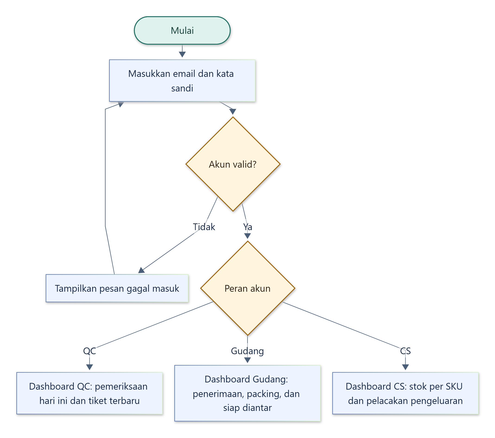
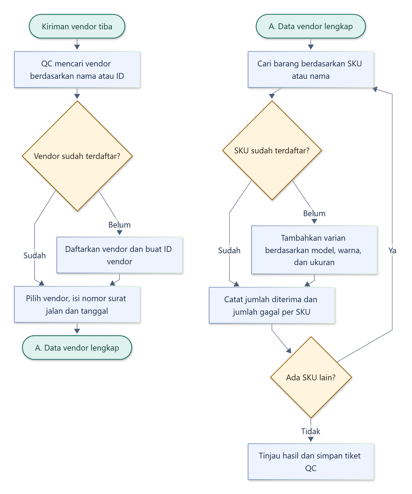
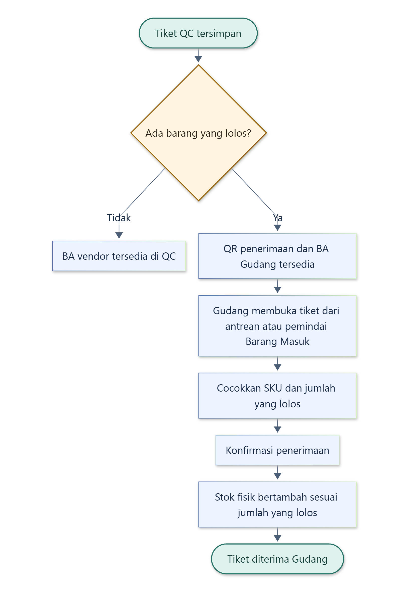
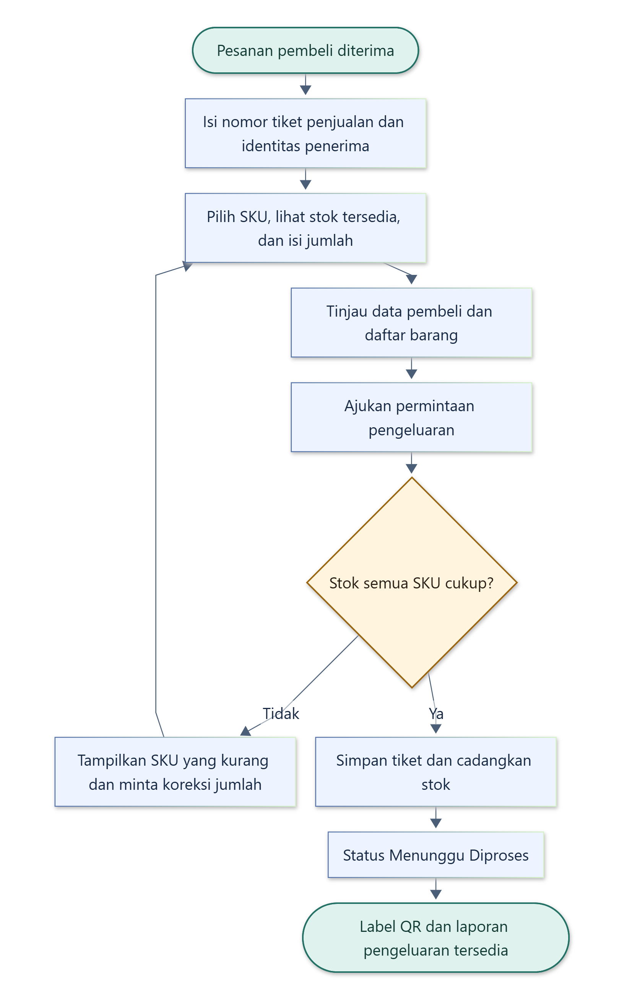
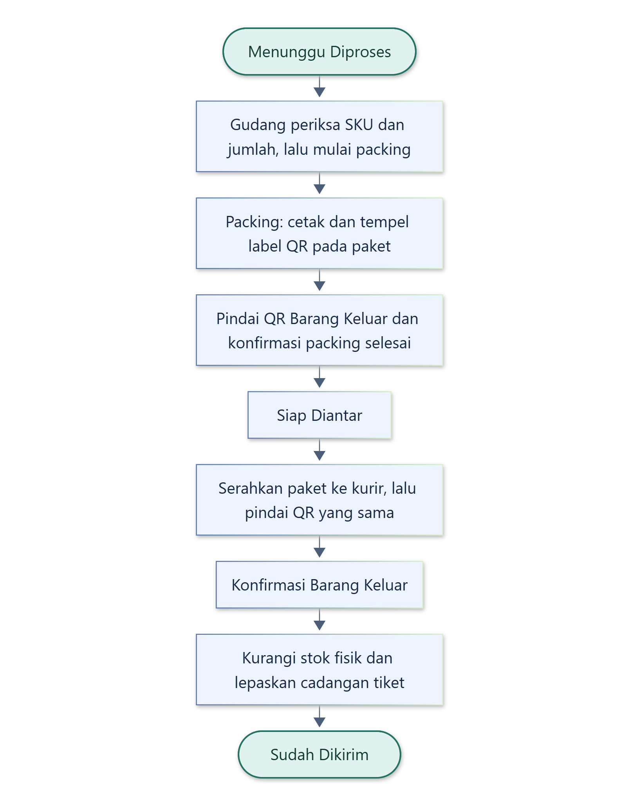
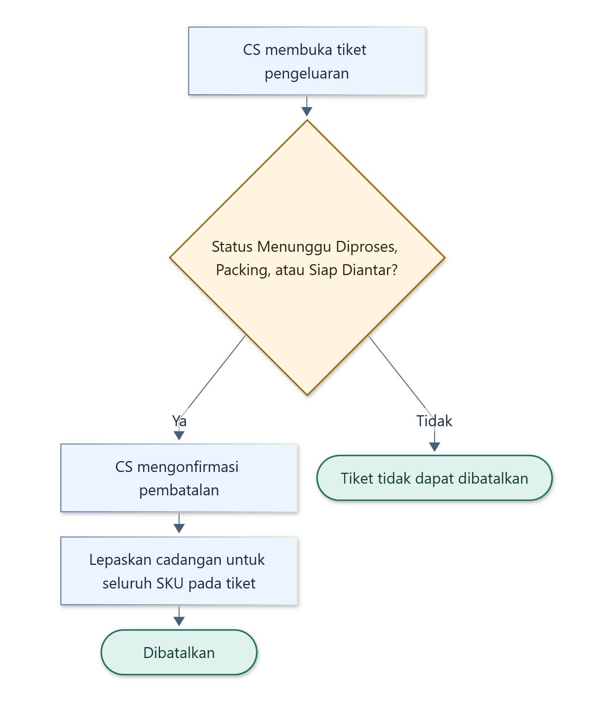

# Flowchart Sistem Inventori

Sistem mencatat barang masuk dari vendor melalui QC, stok siap jual di Gudang, dan barang keluar berdasarkan permintaan CS. Satu tiket QC mewakili satu kiriman dari satu vendor. Satu tiket pengeluaran mewakili satu tiket penjualan untuk satu penerima. Kedua jenis tiket dapat memuat beberapa SKU.

## 1. Login dan dashboard

## 2. QC memeriksa barang dari vendor

Baca panel kiri terlebih dahulu, lalu lanjutkan dari penanda A di panel kanan.

Jumlah yang lolos dihitung dari jumlah diterima dikurangi jumlah gagal. BA vendor menampilkan seluruh hasil pemeriksaan, termasuk barang gagal dan catatan QC.

## 3. Gudang menerima barang yang lolos QC

Untuk membuka tiket melalui pemindai, Gudang dapat memakai kamera, mengunggah gambar QR, atau memasukkan nomor seperti `QC-000001`. Tiket yang seluruh barangnya gagal tetap tercatat di QC. Konfirmasi ulang tiket yang sudah diterima tidak menambah stok lagi.

## 4. CS membuat permintaan pengeluaran

Identitas penerima berisi nama, nomor telepon, dan alamat pengiriman. Sistem memeriksa ulang stok saat permintaan disimpan. Jika salah satu SKU kurang, permintaan ditolak tanpa pencadangan parsial. Setelah tersimpan, tiket mendapat nomor seperti `OUT-000001`. CS dapat mengikuti statusnya di **Pelacakan Tiket**.

## 5. Gudang melakukan packing dan serah terima

Setiap perubahan status mencatat waktu dan petugas. QR yang dipindai ulang setelah pengiriman membuka detail dan riwayat tiket tanpa mengurangi stok lagi.

## 6. CS membatalkan tiket sebelum pengiriman

Jika barang sudah dipacking, CS berkoordinasi dengan Gudang untuk mengembalikan barang ke tempat penyimpanan. Pembatalan mengembalikan stok tersedia tanpa mengubah stok fisik.

## Ringkasan perubahan stok

**Stok tersedia = stok fisik − stok dicadangkan.** Contoh berikut memakai satu SKU dengan stok awal nol.

| Tahap | Stok fisik | Dicadangkan | Tersedia |
|---|---:|---:|---:|
| Gudang menerima 10 unit hasil QC | 10 | 0 | 10 |
| CS mengajukan pengeluaran 3 unit | 10 | 3 | 7 |
| Packing selesai dan paket siap diantar | 10 | 3 | 7 |
| Gudang mengonfirmasi serah terima kepada kurir | 7 | 0 | 7 |

Jika tiket 3 unit tersebut dibatalkan sebelum serah terima, stok menjadi **10 fisik, 0 dicadangkan, dan 10 tersedia**.

## Ekspor ke PDF

1. Buka dokumen ini di pratinjau Markdown. Simpan folder `output/flowchart-inventory` di lokasi relatif yang sama agar keenam gambar tampil.
2. Pilih **Cetak**, gunakan kertas **A4**, dan pilih **Simpan sebagai PDF**.
3. Periksa pratinjau cetak. Jika diagram terpotong, letakkan setiap diagram pada halaman tersendiri di alat ekspor atau sesuaikan skala sebelum menyimpan.
